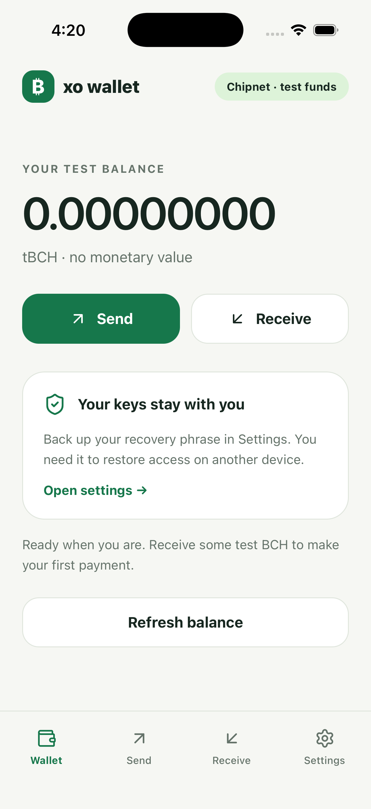

# XO Wallet · React Native Bitcoin Cash starter

A small wallet you can run, understand, and turn into your own app. **Send BCH,
receive with a QR code, and switch between Chipnet and Mainnet in Settings.**
Chipnet is the default and uses test funds with no monetary value.

Built with React Native 0.81.5, React 19.1, real
[`@xo-cash/primitives`](https://stack.xo.cash/api/), and native libauth crypto.
The two reusable packages live in a [separate repository](https://github.com/salemkode/react-native-libauth).
This app consumes their release tarballs; it contains no copied wallet core or
crypto implementation.



## Get running

Install Node 22+, npm, and the native tools for your platform. Use a bare/custom
React Native build; **Expo Go cannot load the native modules**.

```sh
git clone https://github.com/salemkode/xo-react-native-wallet.git
cd xo-react-native-wallet
npm ci
npm run setup:native
npm test
npm run typecheck
npm run lint
```

`setup:native` installs checksum-verified WABT locally and generates the five
native C/JSI modules from the installed upstream libauth. macOS arm64/x64 and
Linux x64 are supported. Linux needs `cmake g++ libssl-dev` first.

### iOS

Install Xcode and CocoaPods, then:

```sh
cd ios
pod install
cd ..
npm start
# In another terminal:
npm run ios -- --udid YOUR_SIMULATOR_UDID --no-packager
```

The project uses Metro **8097**. You can also open `ios/XOWallet.xcworkspace`
and run the `XOWallet` scheme. A physical iPhone needs your own signing team and
bundle identifier. Keep simulator signing enabled: Keychain needs the signed app.
The Podfile includes compatibility settings for Xcode 27.

### Android

Install JDK 17, Android SDK, and the configured NDK. Set `JAVA_HOME` and
`ANDROID_HOME`, start an emulator, then:

```sh
npm start
# In another terminal:
npm run android -- --deviceId YOUR_DEVICE_SERIAL --no-packager
```

If needed: `adb -s YOUR_DEVICE_SERIAL reverse tcp:8097 tcp:8097`.

## Try the wallet

1. Create a wallet or restore an English BIP39 recovery phrase. New keys are
   generated securely on the device; there is no shared demo account.
2. Open Settings and write the recovery phrase somewhere private. Never send it
   to a website, support agent, issue, or chat.
3. Open Receive. Share the QR/address, or use the linked Chipnet faucet to get
   test BCH. Refresh the balance after funding.
4. Open Send, enter a **complete `bchtest:` address** and amount, then review
   the recipient, network, exact fee, and total before confirming.
5. Settings → Mainnet asks for explicit confirmation. Mainnet uses real BCH and
   a separate `bitcoincash:` address and balance. Switching does not move funds.

A lost broadcast response may already have sent the transaction. The app saves
its network and transaction ID before submission and blocks another payment until
its status is checked, including after restarting the app. It never automatically
retries a payment.

## Make it yours

- `App.jsx`: screens, navigation, review, and transaction submission policy.
- `src/vault.js`: Keychain/Keystore seed storage, public settings, pending txids.
- `src/theme.js` and `src/styles.js`: colors and layout.
- `tests/wallet-scenarios.js`: deterministic receive/send scenarios shared by Node
  and the development-only native check screen.
- Native projects: rename the bundle/application ID and add your app icon.

The wallet package owns transaction logic. Keep keys out of UI props, logs,
AsyncStorage, analytics, and Git. Use [the development guide](docs/development.md)
and [agent guide](AGENTS.md) when changing this starter.

## Use the packages without this template

See the [`react-native-xo` integration guide](https://github.com/salemkode/react-native-libauth/tree/HEAD/packages/react-native-xo).
Install the release packages in your own app, run `libauth-native`, and call
`createWallet({mnemonic, network: 'chipnet'})`. Native initialization is automatic.
You can also use `react-native-libauth` alone with the normal upstream libauth API.
The packages are distributed through public GitHub releases, **not the npm registry**.

## Scope and testing

This is an experimental starter, **not an audited production wallet**. It uses
XO's primitives layer, not the full XO Engine or its invitation/contract system.
BIP44 paths are `m/44'/145'/0'/0/0` on Mainnet and `m/44'/1'/0'/0/0` on Chipnet.
It keeps one stable receive/change address per network. It does not discover an
existing wallet's other addresses, support BIP39 passphrases, or restore XO Engine
invitation accounts. Use dedicated development phrases while learning.

BCH only: no token sends, coinbase spending, fiat pricing, address book, or full
transaction history. Tokens are excluded from coin selection. Electrum connects
over WSS, verifies a known fork block and source transactions, and signed
transactions pass libauth VM verification. The server's reported unspent status
is trusted; this is not a full SPV wallet.

See [testing and current evidence](docs/testing.md) for the exact checks and
platform limitations. The Settings → Run native wallet checks action appears
only in development builds and never submits its fixtures to a live network.

MIT license. Upstream XO/libauth and native dependencies retain their own licenses.
